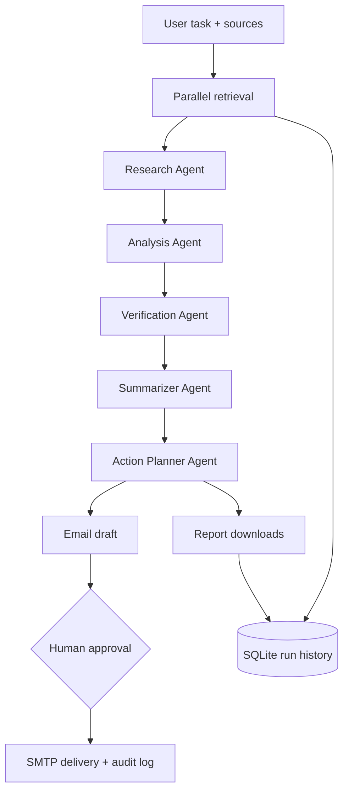

# AgentFlow — Multi-Agent Research & Automation Assistant

A practical final-project MVP demonstrating **multi-agent orchestration, data retrieval, LLM-based analysis, report generation, and human-approved automation**.

The application uses a Streamlit UI, specialized Python agents, the Groq-hosted LLM API, parallel source retrieval, PDF/Markdown/JSON exports, an SMTP email action, and a local SQLite audit dashboard.

## Features

- **Retrieve data:** PDF, TXT/Markdown/log, CSV/TSV, Excel (`.xlsx`/`.xls`), JSON, SQLite database files, HTTP(S) JSON/text/CSV endpoints, and publicly accessible Google Sheets CSV export URLs.
- **Five specialist agents:** `ResearchAgent`, `AnalysisAgent`, `VerificationAgent`, `SummarizerAgent`, and `ActionPlannerAgent`. A separate retrieval stage collects sources concurrently.
- **Summarize and verify:** grounded research brief, findings/risks, verification notes, and an executive-ready Markdown report.
- **Automate carefully:** create downloadable Markdown, PDF, and JSON run artifacts; prepare an email draft; send only after the user reviews it and presses the approval button.
- **Dashboard:** SQLite-backed history, successful-run rate, average run duration, and email action count.
- **Testable orchestration:** `pytest` tests use a fake LLM client and need no API key.
- **Demo mode:** demonstrates the workflow without calling an LLM. Demo text is clearly labeled and must not be represented as AI analysis.

## Architecture



### Why this counts as multi-agent orchestration

Each specialist has a distinct prompt, interface, input, and output. The workflow passes the Research Agent's evidence to Analysis, passes the analysis to Verification, uses the verification notes when writing the report, and gives the verified report to the Action Planner. The orchestrator records the completion status of each step and retains partial outputs if a later step fails. Retrieval calls are concurrent; reasoning steps are sequential because later agents depend on earlier outputs.

## Requirements

- Python 3.10 or newer (Python 3.11 is recommended)
- A Groq API key for real LLM-powered analysis: <https://console.groq.com/>
- SMTP credentials only if you want to send emails. Reports can be generated without SMTP configuration.

The default model is `openai/gpt-oss-20b`; models and access can change, so select a model available in your Groq account. See the [Groq supported models page](https://console.groq.com/docs/models) and [text generation guide](https://console.groq.com/docs/text-chat).

## Run locally on Windows / PowerShell

From the project directory:

```powershell
py -3.11 -m venv .venv
.\.venv\Scripts\Activate.ps1
python -m pip install --upgrade pip
pip install -r requirements.txt
Copy-Item .env.example .env
```

Open `.env` and set `GROQ_API_KEY`. Do not paste your real key into source code or commit `.env` to Git. Then run:

```powershell
python -m streamlit run app.py
```

Open the local URL printed by Streamlit (usually `http://localhost:8501`).

### Try it without an API key

In the sidebar, turn on **Demo mode (no LLM API call)**, upload `sample_data/sales.csv` and `sample_data/management_brief.txt`, then run the workflow. Demo mode proves that retrieval, workflow transitions, reports, and persistence work; it does not provide real model-based insights.

### Try with Groq

1. Turn off Demo mode.
2. Set `GROQ_API_KEY` in `.env` or enter it into the session-only password input.
3. Upload the two sample files.
4. Use the default task or ask a specific question, for example: “Compare revenue and return patterns by product, identify what needs investigation, and prepare a short management update.”
5. Inspect the agent trace, report, and source previews.

## Supported source formats

| Source | How to provide it | Notes |
|---|---|---|
| PDF | Upload `.pdf` | Extracts selectable text. Scanned PDFs need OCR, which is not included yet. |
| CSV / TSV / Excel | Upload `.csv`, `.tsv`, `.xlsx`, `.xls` | Adds row/column metadata and a deterministic numeric summary for tabular inputs. |
| Text / JSON | Upload `.txt`, `.md`, `.log`, `.json` | Useful for policies, briefs, and structured payloads. |
| SQLite | Upload `.db`, `.sqlite`, `.sqlite3` | Reads table previews in read-only mode, up to 100 rows per table. |
| REST API | Enter an HTTP(S) URL and optional JSON headers | Supports JSON, text, and CSV responses; an individual retrieval failure is logged. |
| Google Sheets | Publish/export a sheet as CSV and enter the HTTPS export URL | For private sheets, provide an authenticated API endpoint/header or add a dedicated service-account connector. Never publish confidential data publicly for convenience. |

The MVP downloads up to 3 MB per URL and limits each source preview to control prompt size. Table previews are capped to the first 40 rows in prompts; the numeric summary covers the rows loaded into pandas.

## Email automation setup

Email is intentionally **human-in-the-loop**. The app only calls SMTP when a user reviews the generated recipient, subject, and body and clicks **Send approved email**.

Set the optional variables in `.env`:

```dotenv
SMTP_HOST=smtp.example.com
SMTP_PORT=587
SMTP_USERNAME=your_email@example.com
SMTP_PASSWORD=your_smtp_or_app_password
SMTP_FROM=your_email@example.com
```

For port `465`, the app uses SMTP over SSL. For other ports, it requests STARTTLS before login. Use a provider-approved app password or SMTP credential, not your normal account password when the provider requires app passwords. Keep secrets out of Git and screenshots.

## Run the tests

```powershell
pytest -q
```

The tests validate table ingestion, text ingestion, sequential agent orchestration, and SQLite run/email-event logging without calling Groq or sending email.

## Run using Docker

Create `.env` as described above, then:

```powershell
docker compose up --build
```

Open `http://localhost:8501`. The SQLite audit database is stored in a named Docker volume.

## Project layout

```text
multi_agent_research_automation/
├── app.py                         # Streamlit interface
├── src/
│   ├── actions.py                 # PDF export and approved SMTP action
│   ├── ingestion.py               # Parallel file / API / SQLite retrieval
│   ├── llm_client.py              # Groq client and explicit demo client
│   ├── models.py                  # Input, source, result data classes
│   ├── storage.py                 # SQLite run history / audit events
│   ├── workflow.py                # Orchestration and agent trace
│   ├── workflow_utils.py          # JSON export
│   └── agents/specialists.py      # Five specialist agents
├── sample_data/                   # Synthetic demo data
├── tests/                         # Automated unit tests
├── .env.example
├── Dockerfile
├── docker-compose.yml
└── requirements.txt
```

## Evaluation plan

| Criterion | How to test | Evidence to show in the demo |
|---|---|---|
| Retrieval reliability | Upload a PDF/text/table and a valid API URL; include one invalid URL | Source list, row/page metadata, and per-source error handling |
| Orchestration | Run with Groq and inspect the trace | Five specialist agent steps, ordered by dependency |
| Grounding | Compare cited findings against uploaded source content | Source references and Verification Agent notes |
| Automation | Download report; configure SMTP and approve an email | PDF/Markdown output and logged email outcome |
| Persistence | Refresh or open Run History | SQLite-backed history and summary metrics |
| Efficiency | Repeat the same task and compare elapsed duration | Recorded duration metric; avoid claiming a speedup without measured runs |
| Testability | Run `pytest -q` | Passing unit tests using a fake LLM |

## Known limitations and future improvements

- Verification is model-based, not formal proof or guaranteed fact-checking.
- The first version is sequential after retrieval; parallel independent analysis branches and a supervisor/retry policy could be added later.
- Google Sheets support is via an accessible CSV export/API URL, not a full OAuth/service-account setup wizard.
- No OCR for image-only PDFs, no built-in vector database/RAG index, and no scheduled background runs in this MVP.
- Production deployment should add authentication, rate limiting, secret management, stronger URL/network restrictions, and structured telemetry.

## Suggested face-cam demo (4–6 minutes)

1. **Problem and goal (30 sec):** explain that manually collecting sources, summarizing them, and drafting a follow-up takes multiple steps.
2. **Architecture (60 sec):** show parallel retrieval and explain what each specialist agent contributes.
3. **Live run (90 sec):** upload the synthetic CSV and management brief, then run the workflow with Groq configured.
4. **Quality check (45 sec):** open the evidence, verification notes, and source previews; mention that model outputs still need review.
5. **Automation (45 sec):** download the report and show the email draft. Only send to a test inbox after reviewing it and configuring SMTP.
6. **Testing and dashboard (45 sec):** show `pytest -q`, then open the dashboard to demonstrate persisted run history.
7. **Limitations and next steps (30 sec):** note OCR, private Google Sheets OAuth, authentication, and scheduled workflows as future work.

## References

- [Groq supported models](https://console.groq.com/docs/models)
- [Groq text generation](https://console.groq.com/docs/text-chat)
- [Streamlit downloads](https://docs.streamlit.io/develop/api-reference/widgets/st.download_button)
- [gspread documentation](https://docs.gspread.org/en/latest/) (for a future private Google Sheets connector)
